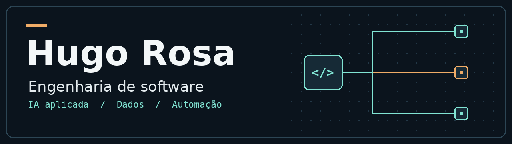

  <a href="https://hugorosa.dev.br/#projetos"><strong>Ver projetos</strong></a>
  · <a href="https://www.linkedin.com/in/hugoluizrosa/">LinkedIn</a>
  · <a href="https://github.com/hugors?tab=repositories">Repositórios</a>
  · <a href="https://www.instagram.com/atentus.cloud/">Atentus Cloud</a>

## Sobre mim

Sou **Hugo Rosa**, desenvolvedor de software no Rio de Janeiro. Trabalho com sistemas corporativos, automação de processos e produtos que integram IA, dados e APIs.

Na **Claro Brasil**, desenvolvo ferramentas internas em Python, automações e soluções de BI com SQL Server. Na **Universidade Castelo Branco**, trabalho com portais institucionais, integrações com TOTVS RM e modernização de aplicações. Na **Atentus Cloud**, desenvolvo produtos para atendimento, vendas e operação pelo WhatsApp.

## Projetos em destaque

| Projeto | O que faz |
| :--- | :--- |
| **Atentus Gateway** | Gerencia múltiplas sessões de WhatsApp, com filas de entrega, monitoramento e recuperação de instâncias. **Node.js · Redis · BullMQ** |
| **ProspectLead** | Organiza a jornada dos leads da captura ao acompanhamento, com landing pages, campanhas e automações por e-mail e WhatsApp. **PHP · MariaDB** |
| **OmniChannel** | Reúne conversas de diferentes canais em uma central de atendimento em tempo real para múltiplas empresas. **React · Node.js · Socket.IO** |
| **AgendaCasa** | Permite criar, consultar e reagendar compromissos pelo WhatsApp, com integração ao Google Calendar. **LLMs · WhatsApp · Google Calendar** |
| **Portal de Protocolos UCB** | Centraliza a abertura e o acompanhamento de protocolos acadêmicos, com integração ao TOTVS RM e histórico de tramitação. **PHP · SQL Server · TOTVS RM** |

[Conheça os projetos no portfólio →](https://hugorosa.dev.br/#projetos)

## Tecnologias

| Área | Ferramentas |
| :--- | :--- |
| **Desenvolvimento** | PHP, Python, JavaScript, Node.js, React, APIs REST e webhooks |
| **IA e automação** | OpenAI API, LLMs, RAG, agentes e n8n |
| **Dados e mensageria** | SQL Server, PostgreSQL, MariaDB, Power BI, Redis e BullMQ |
| **Infraestrutura** | Docker, Docker Compose, Linux, Nginx, Apache e Git |

Referência para a estrutura do perfil: <a href="https://github.com/felipeAguiarCode">Felipe Aguiar</a>.
"# hugors" 
